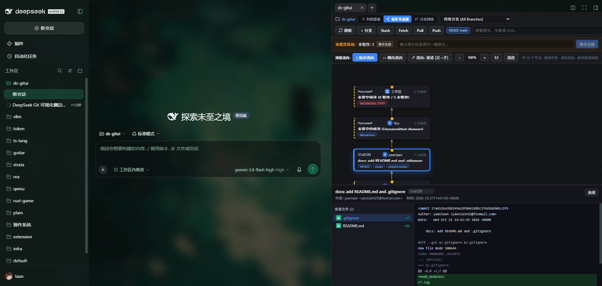
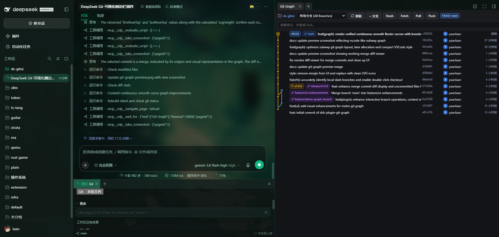
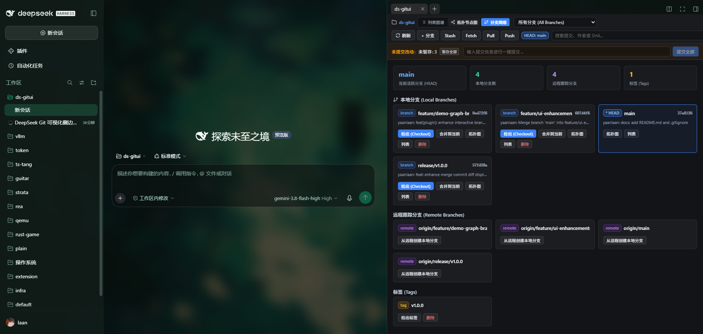

# ds-gitui 🌿

A visual Git graph and repository control plugin for **DeepSeek Harness** (Desktop & Web).  
Directly embedded into DeepSeek Harness's right sidebar, featuring a **VSCode Git Graph-style smooth continuous Bézier subway graph**, interactive branch operations, commit inspections, file diff viewer, and staging controls.

---

## 📸 Previews

### 1. DAG 拓扑节点图 (2D 自由缩放/平移拓扑关系图)


### 2. 地铁折线图 (VSCode Git Graph 风格平滑贝塞尔曲线)


### 3. 分支网络概览 (分支派生状态与一键管理)


---

## ✨ Features

- **三重视图可视化切换 (3 Visual View Modes)**:
  - 🚇 **列表图谱 (Subway Table Graph)**: 类似 VSCode Git Graph 的全局平滑三次贝塞尔曲线连续轨道、分支分流与合流，高对比度剔除外描边与详细提交表格。
  - 🕸️ **DAG 拓扑节点图 (DAG Topology Graph)**: 自由 2D 画布，将 Git 提交以真实有向无环图节点呈现，支持：
    - **自由平移与缩放**：支持鼠标滚轮缩放、拖拽平移、一键适应视口与 1:1 重置；
    - **纵向/横向排版流向切换**：支持时间由上至下流动（纵向）与由左至右流动（横向）；
    - **拓扑箭头指示**：演进流向（父→子）与溯源流向（子→父）自由切换；
    - **血缘链路悬停高亮**：鼠标悬停任意提交节点时自动高亮其父节点与子节点全路径；
    - **节点卡片与抽屉详情**：点击节点卡片直接展开文件变更统计与语法高亮 Diff 抽屉。
  - 🌿 **分支拓扑网络 (Branch Network)**: 分支聚合视图，直观查看所有本地/远程分支最新提交、检出、合并到当前、跳转对应图谱与删除。
- **无缝集成 DeepSeek Harness 右侧边栏**:
  - 注册为 DeepSeek Harness 原生侧边栏 Tab（`ds-gitui`）与引导卡片；
  - 自动绑定当前活跃会话的工作区（`cwd`），支持工作区快速切换；
  - 支持右侧边栏折叠、全屏放大与多标签分栏。
- **全功能交互式 Git 仓储操作**:
  - 右键上下文菜单：检出、基于提交建分支、创建标签、Cherry-pick、Revert、Reset、复制 SHA 等；
  - 快速工具栏：分支过滤、一键刷新、新建分支、Stash 暂存与弹出、Fetch、Pull、Push；
  - 快捷键盘支持：新建分支/标签/Stash 对话框支持按 Enter 快速提交。
- **工作区变更与快速暂存/提交**:
  - 实时检测未暂存与已暂存文件改动；
  - 一键暂存全部（Stage All）、取消暂存全部；
  - 侧边栏内直接输入 Commit Message 进行一键提交。
- **高性能 & 安全沙箱隔离**:
  - 安全子进程调用与临时文件重定向管道，彻底避免沙箱环境下的 EPERM 错误。

---

## 🚀 Installation

1. Clone or link `ds-gitui` into your DeepSeek Harness profile directory (e.g. `~/.dsh/profiles/desktop`):

```bash
cd ~/.dsh/profiles/desktop/node_modules
# On Windows PowerShell:
New-Item -ItemType Junction -Target "C:\Users\<user>\Documents\deepseek\ds-gitui" -Path "ds-gitui"
```

2. Add `ds-gitui` to `~/.dsh/profiles/desktop/package.json`:

```json
{
  "dependencies": {
    "ds-gitui": "link:../../../../Documents/deepseek/ds-gitui"
  },
  "dsh": {
    "bundles": [
      "ds-gitui"
    ]
  }
}
```

3. Build the client bundle (if developing from source):

```bash
pnpm run build
# or node build.mjs
```

4. Launch or reload DeepSeek Harness. In any session, click **ds-gitui** in the right sidebar or from the "开始" (Guide) tab to start exploring your Git history visually!

---

## 🛠️ Development

- **`build.mjs`**: Compiles client-side React components into standard DSH Cordis client bundle (`lib/client.js`).
- **`src/git-graph-view.js`**: Frontend UI, branch layout solver, and Bézier topology generator.
- **`src/styles.js`**: Scoped styles matching DSH dark theme tokens.
- **`lib/git-service.js`**: Host-side Git operations and parser service.
- **`lib/index.js`**: Host plugin entry exposing `/api/git-graph/*` endpoints.

---

## 📄 License

MIT © [yaanlaan](https://github.com/yaanlaan)
